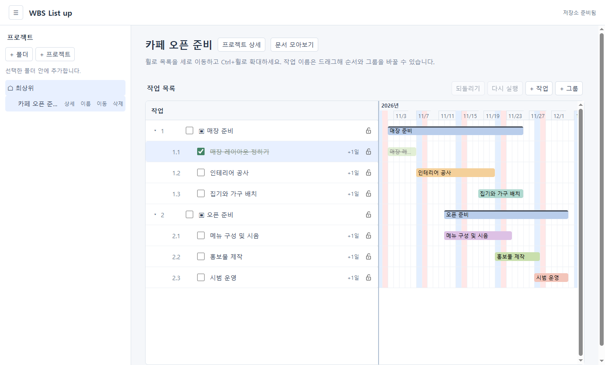
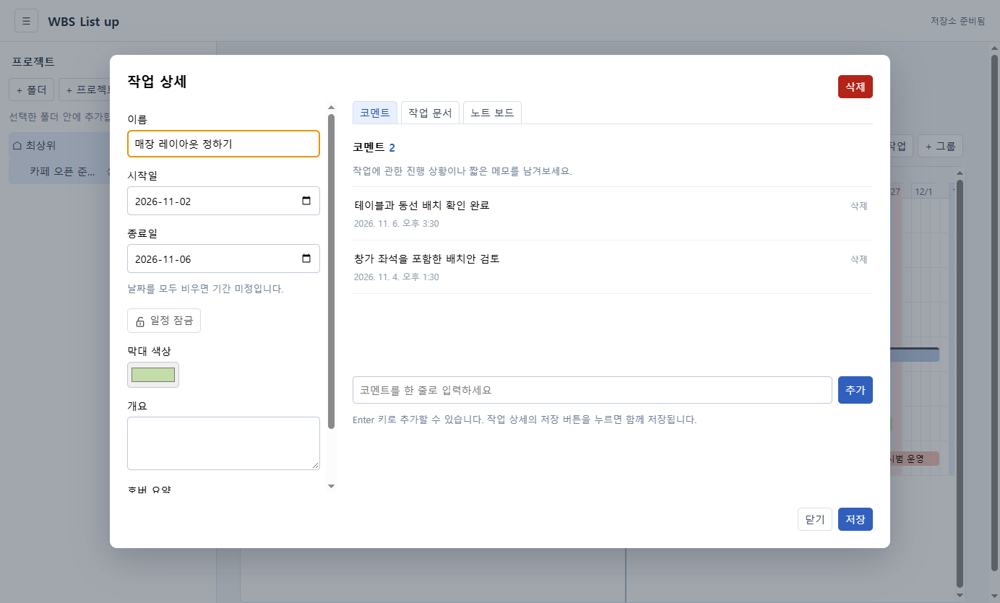
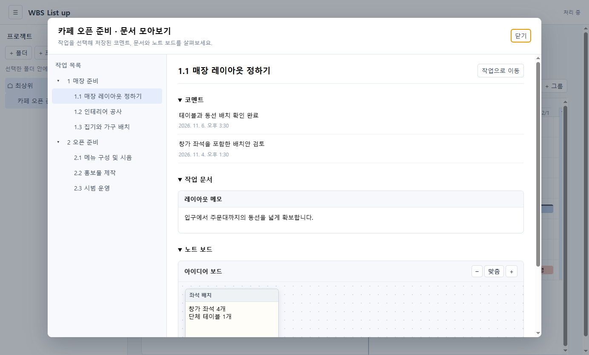

# WBS List up

현재 버전은 **1.3.0**입니다. [업데이트 내역](CHANGELOG.md)에서 이전 버전과의 차이를 확인할 수 있습니다.

Windows용 개인 프로젝트·일정 관리 앱입니다. 프로젝트와 작업 계층을 관리하고 타임라인에서 일정을 살펴볼 수 있습니다. 작업을 더블클릭해 날짜·개요·막대 색상을 편집하고, 휠로 세로 이동하거나 Ctrl+휠로 확대·축소합니다. 시간 이동은 빈 공간을 드래그합니다. 작업 막대를 드래그해 날짜를 옮기고 잠금 버튼으로 일정 변경을 차단할 수 있습니다. 상세 창의 노트 보드와 작업 문서도 같은 저장 버튼으로 함께 저장합니다. 프로젝트 이름 옆 `프로젝트 상세`에서는 문서를 폴더로 정리하고 프로젝트 노트 보드를 사용할 수 있습니다. 보드의 빈 공간을 클릭한 뒤 이미지를 붙여넣고 저장할 수 있습니다. `문서 모아보기`에서는 작업 계층별로 저장된 문서와 보드를 확인하고 해당 작업으로 이동할 수 있습니다.

## 1.3.0 업데이트

- **MCP 문서 동시 편집** — 같은 작업이나 프로젝트에서 사용자가 문서를 편집하는 동안 에이전트가 다른 문서를 추가·수정·삭제할 수 있습니다.
- **초안 보존** — 에이전트가 저장한 변경 사항은 열린 상세 화면에 반영되며, 사용자 초안과 커서 위치는 유지됩니다.
- **문서 충돌 방지** — 사용자가 편집 중이거나 미저장 변경이 있는 문서의 에이전트 수정·삭제를 차단하고, 작업 상세를 저장할 때 변경한 문서만 반영합니다.

## 1.2.0 업데이트

- **콘텐츠 개수** — 작업·작업 그룹·프로젝트에 등록된 항목의 개수를 표시하고, 숫자를 누르면 해당 상세 탭을 엽니다.
- **작업 목록 정렬** — 작업과 작업 그룹의 개수 아이콘과 자물쇠를 같은 열에 배치합니다.
- **작업 상세** — 기본 정보 패널을 접거나 펼칠 수 있으며, 마지막 상태를 작업별로 기억합니다.
- **패널 아이콘** — 프로젝트 목록과 작업 상세의 접기·펼치기 아이콘을 현재 상태에 맞춰 표시합니다.
- **수정일 포함** — 일정이 잠기지 않은 작업에서 옵션을 켜면 작업 변경 시 수정일을 포함하도록 기간을 넓힙니다.
- **작업 문서** — 작업과 작업 그룹에서 `+ 문서`를 누를 때 첫 작업 문서를 만듭니다.
- **노트 보드** — 작업과 작업 그룹에서 `+ 보드`를 누를 때 첫 노트 보드를 만듭니다.
- **Windows 자동 실행** — 설정에서 Windows 로그인 시 앱을 자동으로 실행할 수 있습니다.
- **시스템 트레이** — 창 닫기를 트레이 숨기기로 설정하고, 트레이에서 다시 열거나 종료할 수 있습니다.
- **중복 실행 방지** — 앱을 다시 실행하면 이미 열린 창을 표시합니다.
- **앱 아이콘** — 앱 창과 트레이에 체크리스트 폴더 아이콘을 표시합니다.

## 화면 예시

아래 화면은 기능 설명을 위한 예시 데이터입니다.

**작업과 일정 관리** — 작업 계층, 일정 막대와 완료 상태를 확인합니다.



**작업 상세** — 코멘트, Markdown 문서, 노트 보드와 첨부파일을 관리합니다. 오른쪽 아래 모서리를 드래그하면 상세 창 크기를 조절할 수 있습니다.



**문서 모아보기** — 작업별 코멘트, 문서, 첨부파일과 노트 보드를 한곳에서 확인합니다.



## 실행

Node.js 26 LTS(26.13.1 이상 권장)와 npm이 필요합니다.

```powershell
npm install
npm start
```

또는 의존성 설치 후 `WBS List up.vbs`를 더블클릭합니다. 콘솔 창 없이 실행됩니다.

데이터는 개발 실행 기준 `%APPDATA%\WBS List up\data\wbs-list-up.sqlite`에 저장합니다. 첨부파일은 같은 데이터 폴더의 `attachments`에 보관합니다. 새 위치에 DB가 없으면 기존 `%APPDATA%\PlanWeave\data\planweave.sqlite`를 복사하며 원본은 보존합니다. 이전 앱과 새 앱의 저장 경로가 다르면 데이터가 따로 저장됩니다.

## 검증

```powershell
npm test
```

개발 진행과 검증 결과는 [단계별 개발·검증 계획](plans/단계별-개발-검증-계획.md)을 참고하세요. 설치 파일은 아직 제공하지 않습니다.

## 에이전트 연결

WBS List up을 실행한 상태에서 MCP 서버 `wbs-list-up`을 통해 프로젝트와 작업, 문서를 조회하고 변경할 수 있습니다. Codex에서 전역 등록하려면 다음 명령을 실행하세요. 이미 등록한 경우 다시 실행할 필요가 없습니다.

```powershell
codex mcp add wbs-list-up -- "C:\Program Files\nodejs\node.exe" "F:\Github\WBSListup\src\agent-mcp.js"
```

경로가 다른 컴퓨터에서는 Node 실행 파일과 이 프로젝트의 `src/agent-mcp.js` 경로를 바꿉니다. 등록 후 새 Codex 세션에서 도구를 사용할 수 있습니다. 이미 실행 중이면 기존 앱 창이 열립니다.

- `list_projects`, `get_workspace`로 ID, 기존 데이터와 revision을 조회합니다.
- `apply_changes`로 프로젝트·작업 생성, 작업 이름·일정·막대 색상 변경, 프로젝트·작업 문서 생성·수정·삭제를 한 번에 저장합니다. 일괄 요청 안에서 새 항목을 참조하려면 ID를 직접 지정합니다.
- 문서의 `text`에는 Markdown 원문을 입력합니다. 기존 문서를 업데이트하면 본문 전체가 교체됩니다. 조회한 `content`는 `schemaVersion`이 2이면 Markdown 문자열이고, 1이면 기존 Tiptap JSON입니다.
- 작업이나 프로젝트 상세에서 문서를 편집하는 동안 에이전트는 다른 문서를 저장할 수 있습니다. 편집 중이거나 미저장 변경이 있는 문서에는 수정·삭제가 차단됩니다. 상세가 열린 동안 일정 등 문서 외 변경은 창을 닫은 뒤 적용할 수 있습니다. 조회 이후 저장된 데이터가 바뀌면 최신 revision을 다시 조회하세요.
