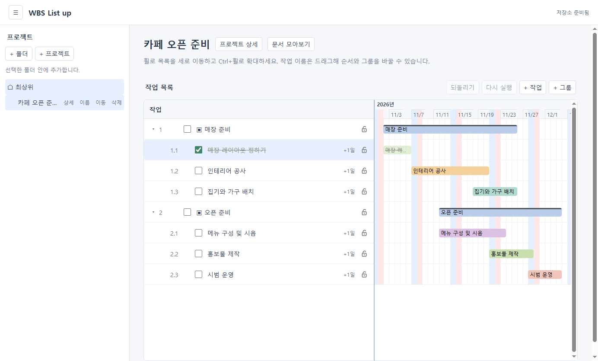
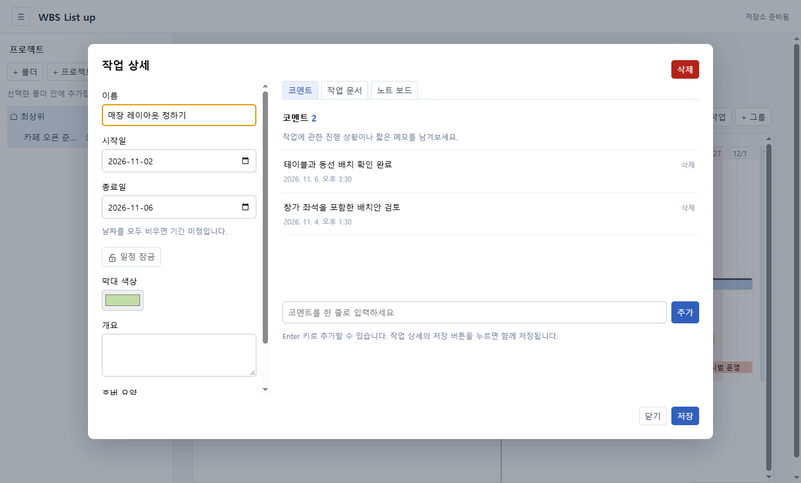
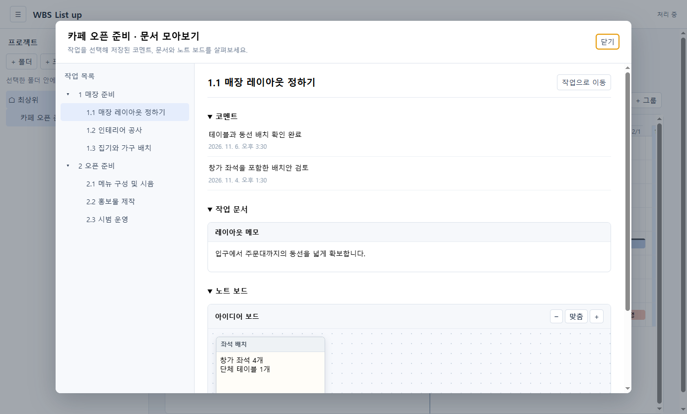

# WBS List up

Windows용 개인 프로젝트·일정 관리 앱입니다. 프로젝트와 작업 계층을 관리하고 타임라인에서 일정을 살펴볼 수 있습니다. 작업을 더블클릭해 날짜·개요·막대 색상을 편집하고, 휠로 세로 이동하거나 Ctrl+휠로 확대·축소합니다. 시간 이동은 빈 공간을 드래그합니다. 작업 막대를 드래그해 날짜를 옮기고 잠금 버튼으로 일정 변경을 차단할 수 있습니다. 상세 창의 노트 보드와 작업 문서도 같은 저장 버튼으로 함께 저장합니다. 프로젝트 이름 옆 `프로젝트 상세`에서는 문서를 폴더로 정리하고 프로젝트 노트 보드를 사용할 수 있습니다. 보드의 빈 공간을 클릭한 뒤 이미지를 붙여넣고 저장할 수 있습니다. `문서 모아보기`에서는 작업 계층별로 저장된 문서와 보드를 확인하고 해당 작업으로 이동할 수 있습니다.

## 화면 예시

아래 화면은 기능 설명을 위한 예시 데이터입니다.

**작업과 일정 관리** — 작업 계층, 일정 막대와 완료 상태를 확인합니다.



**작업 상세** — 코멘트, 작업 문서와 노트 보드를 작성합니다.



**문서 모아보기** — 작업별 코멘트, 문서와 노트 보드를 한곳에서 확인합니다.



## 실행

Node.js 26 LTS(26.13.1 이상 권장)와 npm이 필요합니다.

```powershell
npm install
npm start
```

또는 의존성 설치 후 `WBS List up.vbs`를 더블클릭합니다. 콘솔 창 없이 실행됩니다.

저장 위치: `%APPDATA%\WBS List up\data\wbs-list-up.sqlite` (개발 실행 기준). 새 위치에 DB가 없으면 기존 `%APPDATA%\PlanWeave\data\planweave.sqlite`를 복사하며 원본은 보존합니다. 이전 버전과 새 버전을 동시에 사용하면 데이터가 따로 저장됩니다.

## 검증

```powershell
npm test
```

개발 진행과 검증 결과는 [단계별 개발·검증 계획](plans/단계별-개발-검증-계획.md)을 참고하세요. 설치 파일은 아직 제공하지 않습니다.

## 에이전트 연결

WBS List up을 실행한 상태에서 MCP 서버 `wbs-list-up`을 통해 프로젝트와 작업, 문서를 조회하고 변경할 수 있습니다. Codex에서 전역 등록하려면 다음 명령을 실행하세요. 이미 등록한 경우 다시 실행할 필요가 없습니다.

```powershell
codex mcp add wbs-list-up -- "C:\Program Files\nodejs\node.exe" "F:\Github\WBSListup\src\agent-mcp.js"
```

경로가 다른 컴퓨터에서는 Node 실행 파일과 이 프로젝트의 `src/agent-mcp.js` 경로를 바꿉니다. 등록 후 새 Codex 세션에서 도구를 사용할 수 있습니다. 앱을 한 인스턴스만 실행하세요.

- `list_projects`, `get_workspace`로 ID, 기존 데이터와 revision을 조회합니다.
- `apply_changes`로 프로젝트·작업 생성, 작업 이름·일정·막대 색상 변경, 프로젝트·작업 문서 생성·수정·삭제를 한 번에 저장합니다. 일괄 요청 안에서 새 항목을 참조하려면 ID를 직접 지정합니다.
- 문서의 `text`는 줄마다 일반 문단으로 저장합니다. Markdown 문법은 서식으로 변환하지 않으며, 기존 문서에 저장하면 기존 본문과 서식을 전체 교체합니다.
- 데이터가 조회 이후 바뀌었거나 앱에 대화상자가 열려 있으면 변경이 거절됩니다. 창을 닫고 다시 조회한 뒤 요청하세요. 같은 앱 화면의 미저장 내용을 덮어쓰지 않기 위한 제한입니다.
